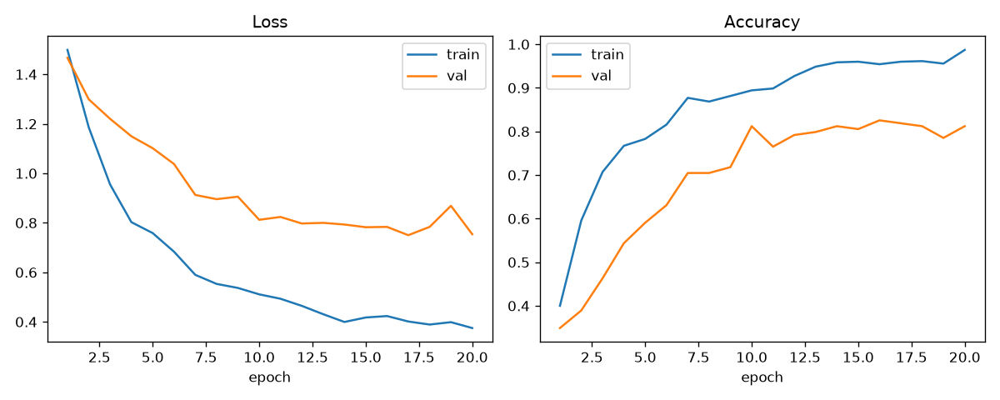

# Этап 10 — улучшенная версия модели

**Статус:** выполнен.

## Что требовалось по плану

> Выбрать одну или несколько обнаруженных проблем и попытаться улучшить
> результат. Реализовано 2 модели с одинаковым тестовым набором, сохранены
> веса обеих моделей.

## Что сделано

| Требование | Как закрыто |
| --- | --- |
| Две модели | `models/stage4.pt` и `models/stage10.pt` |
| Один и тот же тест | `data/processed/splits/test.csv`, md5 `6558276dacea7a8cb19140543a2b71ea` у обеих оценок |
| Выбрана проблема этапа 9 | перекос в `yellow_rust` среди похожих болезней и тёмные кадры |
| Результат лучше | accuracy 0,711 → 0,819, ошибок 43 → 27. Тест в обучении не использовался |

Веб-программа по-прежнему отвечает весами первой модели. Так этапы 6–8 остаются
привязаны к измеренной версии. Вторая модель вызывается отдельно.

## Какие проблемы чинили

Из этапа 9 взяты две, не все сразу.

1. **Похожие болезни и перекос в `yellow_rust`.** 25 из 43 ошибок были между
   жёлтой ржавчиной, бурой ржавчиной и септориозом, из них 20 — ответ
   `yellow_rust`. У первой модели backbone заморожен, свёртки остались
   от ImageNet и плохо разделяют полосы и пятна.
2. **Тёмный кадр.** Плохое освещение встречалось на 30% ошибок и на 14% верных
   ответов. На обучении первой модели яркость качалась только на ±15%.

Мелкий симптом и гипотезу «горшок = мучнистая роса» не трогали: этап 9 показал,
что первое не отделяет ошибки, а второе на этих снимках не подтверждается.

## Чем вторая модель отличается

Обе — MobileNetV3-Small, те же 5 классов, тот же train из 700 снимков.
Менялось только обучение. Конфиг: `configs/train_stage10.yaml`.

| Параметр | Этап 4 | Этап 10 | Зачем |
| --- | --- | --- | --- |
| Backbone | заморожен | обучается | чтобы признаки подстроились под пятна, а не под ImageNet |
| Learning rate | 0,001 на голову | 0,0003 на голову, 0,00005 на backbone | полный шаг 0,001 на свёртках с 700 снимков их сбивает |
| Выбор чекпоинта | val accuracy | val macro F1 | accuracy поощряет частый класс и перекос в `yellow_rust` |
| Яркость / контраст | ±0,15 / ±0,15 | ±0,45 / ±0,30 | тёмные полевые кадры попадают в обучение |
| Label smoothing | 0 | 0,05 | похожим классам не нужно выдавливать вероятность в 1 |
| Эпохи | 10, patience 4 | 20, patience 5 | свёрткам нужно больше шагов |

Чекпоинт выбран по val, эпоха 16: val accuracy 0,826, val macro F1 0,821.
Test в этот момент был закрыт.

## Как запустить

```bash
python -m src.model.train --config configs/train_stage10.yaml --reports-dir reports/stage10
python -m src.model.evaluate --weights models/stage10.pt --out-dir reports/stage10/eval
python -m src.model.compare --candidate reports/stage10/eval/predictions.csv --out reports/stage10/comparison.json
```

Предсказание второй моделью:

```bash
python -m src.model.predict путь/к/снимку.png --weights models/stage10.pt
```

## Результат на одном test

| Метрика | `stage4.pt` | `stage10.pt` |
| --- | --- | --- |
| Accuracy | 0,711 (95% ДИ 0,638–0,785) | **0,819** (95% ДИ 0,752–0,879) |
| Macro F1 | 0,692 (95% ДИ 0,607–0,770) | **0,788** (95% ДИ 0,709–0,856) |
| mAP | 0,778 | **0,880** |
| Ошибок | 43 | **27** |
| Ошибка подсчёта, MAE на класс | 9,2 | **4,0** |
| ECE | 0,094 | 0,047 |

Отдельные интервалы accuracy чуть пересекаются. На одних и тех же 149 кадрах
разница честнее: вторая модель починила 21 ошибку и добавила 5 новых,
прирост accuracy **+0,107** (парный bootstrap, 95% ДИ 0,047–0,168, seed 42).
Ноль в этот интервал не входит.

### По классам, recall

| Класс | Этап 4 | Этап 10 |
| --- | --- | --- |
| `healthy` | 0,611 | 0,667 |
| `yellow_rust` | 0,917 | 0,972 |
| `brown_rust` | 0,474 | 0,579 |
| `septoria` | 0,615 | **0,865** |
| `mildew` | **0,875** | 0,792 |

`septoria` — главный выигрыш. Precision `yellow_rust` вырос с 0,600 до 0,778:
модель всё ещё ставит этот класс чаще, чем нужно (45 предсказаний при 36
снимках вместо 55 при первой модели), но перекос стал меньше.

Recall `mildew` просел. Precision при этом вырос с 0,750 до 0,864, F1 класса
чуть выше (0,808 → 0,826). Это плата за то, что сеть больше смотрит на лист,
а не на удобный признак класса.

### Ошибки, которые чинили

| Истина → предсказание | Этап 4 | Этап 10 |
| --- | --- | --- |
| `septoria` → `yellow_rust` | 14 | **5** |
| `brown_rust` → `yellow_rust` | 6 | **3** |
| `septoria` → `brown_rust` | 2 | 2 |
| `yellow_rust` → `septoria` | 2 | 1 |
| `brown_rust` → `septoria` | 1 | 1 |

Тёмных кадров среди ошибок было 13 из 43. Стало 6 из 27. Доля таких кадров
среди оставшихся ошибок (22%) почти как среди верных ответов (18%): освещение
больше не выделяет ошибки так, как на этапе 9.

`brown_rust` по-прежнему самый слабый класс (recall 0,579). Путаница бурой
ржавчины с жёлтой и с септориозом не исчезла, её стало меньше.



Матрица ошибок второй модели: `reports/stage10/eval/confusion_matrix.png`.

## Решения, принятые на этапе, и их причины

**Не меняли тест и не выбирали эпоху по test.** Иначе прирост был бы подгонкой.
Обе оценки смотрят в файл с одним md5.

**Не заменили модель в веб-программе.** Этап сравнивает две сохранённые модели.
Пользовательский сценарий этапов 6–8 остаётся на `models/stage4.pt`.

**Macro F1 на val, а не accuracy.** Accuracy первой модели держалась на
`yellow_rust` и `septoria`. Метрика выбора должна видеть `brown_rust`.

**Два learning rate.** Голова учится быстрее, backbone — мелким шагом от
весов ImageNet. Один общий шаг 0,001 при разморозке на 700 снимках слишком велик.

**Label smoothing 0,05.** На этапе 9 девять ошибок были с уверенностью ≥ 0,9.
Сглаживание не лечит похожие классы само по себе, но не заставляет сеть
выдавать почти единицу там, где второй класс тоже правдоподобен.

## Артефакты этапа

```
configs/train_stage10.yaml
models/stage4.pt                         первая модель, без изменений
models/stage10.pt                        улучшенная, md5 d0236b8944ab232f514e2867d6370cfd
reports/stage10/train_summary.json
reports/stage10/train_curves.png
reports/stage10/eval/                    метрики и предсказания на test
reports/stage10/comparison.json          пары ошибок и парный прирост accuracy
src/model/compare.py
tests/test_compare.py
```

## Проверка результата

```bash
pytest -q tests/test_compare.py tests/test_model.py
python -m src.model.evaluate --weights models/stage10.pt --out-dir reports/stage10/eval
```

Ожидается: тесты зелёные, оценка печатает accuracy 0,819 и mAP 0,880.
Повторное обучение на MPS даёт те же эпохи при seed 42, но аугментации
случайны внутри эпохи, поэтому val-числа могут слегка сдвинуться.
Зафиксированный результат — сохранённые веса и `reports/stage10/eval`.

## Что дальше, на этапе 11

Программа должна замечать плохой вход: размытый, слишком тёмный, слишком
светлый, слишком мелкий или повреждённый файл. К выбору модели это не привязано.
