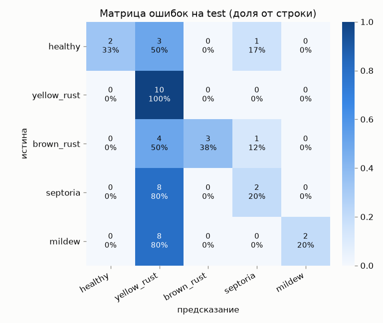
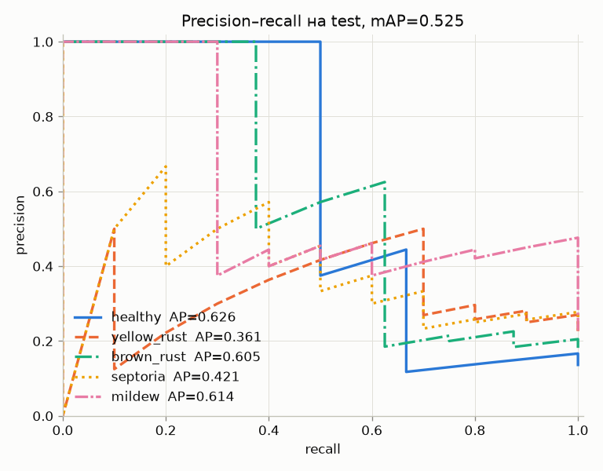

# Этап 14 — независимая проверка итоговой модели

**Статус:** выполнен.

## Что требовалось по плану

> Отдельный независимый набор фотографий. По возможности из другого источника,
> чем основная часть датасета. Получить все характеристики и свойства на новом наборе.

## Что сделано

| Требование | Как закрыто |
| --- | --- |
| Другой источник | Снимки собраны из интернета, не из Zenodo `10.5281/zenodo.7573133`. Имена файлов не совпадают с архивом Long 2023, на части кадров стоит водяной знак Dreamstime |
| Те же метрики, что на этапе 5 | `python -m src.model.evaluate --split-csv data/independent/wheat.csv --out-dir reports/stage14` |
| Итоговая модель | `models/stage4.pt`, md5 `a93ab47ff3af413ef42f2a44ff128246`, тот же файл, которым отвечает сайт |

Папка `data/raw/` на этой машине не скачана, поэтому побайтовое сравнение с архивом Zenodo не запускалось.

## Как собран набор

В `data/independent/` лежат пять папок по классам модели. В подсчёт вошли 44 снимка.
Три файла из папок в CSV не попали:

| Файл | Почему исключён |
| --- | --- |
| `healthy/h3.jpeg` | побайтный дубликат `healthy/h1.jpeg`, md5 `9b4dabe431fd6241f6af3144fd76b6a1` |
| `brown_rust/br9.jpeg`, `brown_rust/br10.jpeg` | пустулы на стебле, это стеблевая ржавчина, а не бурая листовая |

| Класс | Снимков |
| --- | --- |
| `healthy` | 6 |
| `yellow_rust` | 10 |
| `brown_rust` | 8 |
| `septoria` | 10 |
| `mildew` | 10 |

Подписи взяты из имени папки. Отдельного опубликованного датасета с DOI у этого набора нет: исходные адреса страниц при загрузке не сохранялись.

## Как запустить

```bash
python -m src.model.evaluate \
  --weights models/stage4.pt \
  --split-csv data/independent/wheat.csv \
  --out-dir reports/stage14
```

## Что зафиксировано

| Параметр | Значение |
| --- | --- |
| Выборка | `data/independent/wheat.csv`, 44 снимка, md5 `e99dcd930ef8335dbbae34fc8ea50a6e` |
| Веса | `models/stage4.pt`, md5 `a93ab47ff3af413ef42f2a44ff128246` |
| Предобработка | та же, что в `predict()`: Resize 256, CenterCrop 224, нормализация ImageNet |
| Доверительные интервалы | bootstrap, 1000 повторов, seed 42 |
| Устройство прогона | CPU |

Поле `split` в `metrics.json` остаётся `test`: так устроен аргумент скрипта по умолчанию.
Файл выборки записан в `split_csv`.

## Результат

### Общие метрики

| Метрика | Независимый набор | Test этапа 5 |
| --- | --- | --- |
| Accuracy | **0,432** (95% ДИ 0,295–0,591) | 0,711 (0,638–0,785) |
| Balanced accuracy | 0,422 | 0,698 |
| Macro precision | 0,761 | 0,719 |
| Macro recall | 0,422 | 0,698 |
| Macro F1 | **0,426** (95% ДИ 0,234–0,571) | 0,692 (0,607–0,770) |
| Weighted F1 | 0,414 | 0,706 |
| mAP | **0,526** | 0,778 |
| ROC-AUC, macro | 0,719 | 0,929 |
| Top-2 accuracy | 0,659 | 0,893 |
| Log loss | 2,238 | 0,813 |

Интервалы accuracy не пересекаются: падение относительно теста этапа 5 не объясняется
малым числом снимков.

### По классам

| Класс | Precision | Recall | F1 | AP | Снимков | Предсказано | Ошибка подсчёта |
| --- | --- | --- | --- | --- | --- | --- | --- |
| `healthy` | 1,000 | 0,333 | 0,500 | 0,626 | 6 | 2 | −4 |
| `yellow_rust` | 0,303 | **1,000** | 0,465 | 0,361 | 10 | 33 | **+23** |
| `brown_rust` | 1,000 | 0,375 | 0,545 | 0,605 | 8 | 3 | −5 |
| `septoria` | 0,500 | 0,200 | 0,286 | 0,421 | 10 | 4 | −6 |
| `mildew` | 1,000 | 0,200 | 0,333 | 0,614 | 10 | 2 | −8 |

### Ошибка подсчёта

| Показатель | Значение |
| --- | --- |
| Средняя абсолютная ошибка подсчёта на класс | 9,2 снимка |
| Доля снимков, учтённых не в том классе | 0,523 (23 из 44) |

Все 10 снимков жёлтой ржавчины узнаны. Остальные классы модель в основном
тоже относит к `yellow_rust`: туда ушло 33 ответа из 44.

### Матрица ошибок



| Истина → предсказание | Снимков | Доля класса |
| --- | --- | --- |
| `septoria` → `yellow_rust` | 8 | 80% |
| `mildew` → `yellow_rust` | 8 | 80% |
| `brown_rust` → `yellow_rust` | 4 | 50% |
| `healthy` → `yellow_rust` | 3 | 50% |
| `healthy` → `septoria` | 1 | 17% |
| `brown_rust` → `septoria` | 1 | 12% |

### Кривые precision–recall



### Уверенность модели

| Показатель | Значение |
| --- | --- |
| Средняя уверенность на верных ответах | 0,753 |
| Средняя уверенность на ошибках | 0,822 |
| Ошибок с уверенностью ≥ 0,9 | 9 из 25 |
| Ошибок с уверенностью ≥ 0,6 | 22 из 25 |
| Ошибка калибровки (ECE, 10 корзин) | 0,438 |

На этом наборе ошибка чаще увереннее верного ответа. Порог 60% из этапа 12
здесь почти не отсекает ошибки: 22 из 25 ошибок всё равно попали бы в «надёжный» ответ.

## Выводы

1. На чужих фотографиях accuracy 0,432 и mAP 0,526. На тесте того же источника, что и обучение, было 0,711 и 0,778.
2. Перекос в `yellow_rust`, уже видный на этапе 5, здесь стал основным режимом ответа: recall класса 1,000 при precision 0,303.
3. Precision 1,000 у `healthy`, `brown_rust` и `mildew` держится на двух-трёх ответах. Это не устойчивость класса, а редкость, с которой модель вообще выбирает эти имена.
4. Высокая уверенность на ошибках означает, что показ процента на сайте не предупреждает пользователя об этом сдвиге.

## Ограничения набора

Набор маленький: 44 снимка, у `healthy` только 6. Часть кадров — общий вид поля или колос, а не лист крупным планом, как в обучении. У нескольких файлов есть водяной знак. Подписи не проверены вторым экспертом и не привязаны к публикации. Поэтому числа описывают эти 44 файла, а не все полевые снимки пшеницы.

Сами jpeg в git не входят: в `.gitignore` закрыты картинки из `data/independent/`. В репозитории остаются CSV, метрики и графики.

## Артефакты этапа

```
data/independent/wheat.csv
reports/stage14/metrics.json
reports/stage14/predictions.csv
reports/stage14/confusion_matrix.png
reports/stage14/pr_curves.png
```

## Проверка результата

```bash
python -m src.model.evaluate \
  --weights models/stage4.pt \
  --split-csv data/independent/wheat.csv \
  --out-dir reports/stage14
```

Ожидается: 44 изображения, accuracy 0,432, mAP 0,526.
