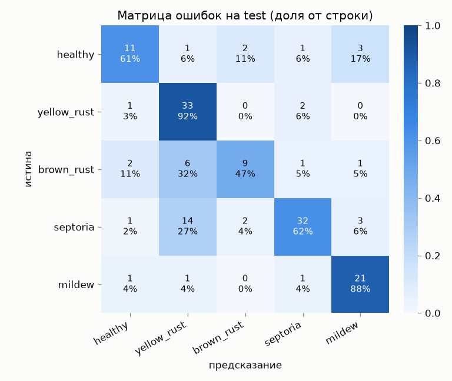
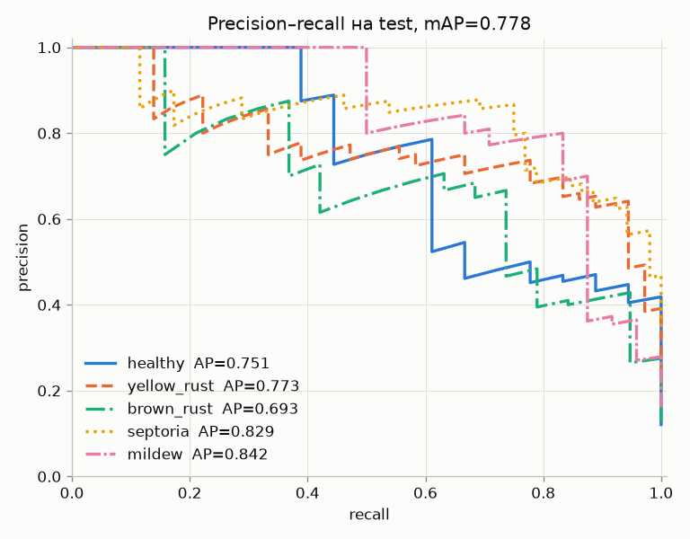

# Этап 5 — измерение исходного качества

**Статус:** выполнен.

## Что требовалось по плану

> На фиксированном тестовом наборе рассчитываются согласованные метрики,
> например: precision, recall, mAP, показатели ошибки подсчёта.

## Что сделано

| Требование | Как закрыто |
| --- | --- |
| Фиксированный тестовый набор | `data/processed/splits/test.csv` из этапа 3, 149 снимков. В обучении и выборе чекпоинта не участвовал. md5 файла записан в отчёт |
| Precision, recall | по каждому классу, плюс macro- и weighted-среднее |
| mAP | среднее по классам значение average precision (площадь под кривой precision–recall «класс против остальных») |
| Ошибка подсчёта | для каждого класса: сколько снимков модель отнесла к классу минус сколько их там на самом деле |
| Согласованность | всё считает один скрипт `src/model/evaluate.py` с фиксированным seed. На этапе 10 улучшенная модель проверяется той же командой на том же файле |

## Как запустить

```bash
python -m src.model.evaluate
```

Другие веса или другая выборка:

```bash
python -m src.model.evaluate --weights models/другие.pt --split val --out-dir reports/tmp
```

## Что зафиксировано

| Параметр | Значение |
| --- | --- |
| Выборка | `data/processed/splits/test.csv`, md5 `6558276dacea7a8cb19140543a2b71ea` |
| Веса | `models/stage4.pt`, md5 `a93ab47ff3af413ef42f2a44ff128246` |
| Предобработка | та же, что в `predict()`: Resize 256, CenterCrop 224, нормализация ImageNet |
| Доверительные интервалы | bootstrap, 1000 повторов, seed 42 |

Предсказанные классы на MPS и на CPU совпадают на всех 149 снимках,
вероятности расходятся меньше чем на 0,0001.

## Результат

### Общие метрики

| Метрика | Значение |
| --- | --- |
| Accuracy | **0,711** (95% ДИ 0,638–0,785) |
| Balanced accuracy | 0,698 |
| Macro precision | 0,719 |
| Macro recall | 0,698 |
| Macro F1 | **0,692** (95% ДИ 0,607–0,770) |
| Weighted F1 | 0,706 |
| mAP | **0,778** |
| ROC-AUC, macro | 0,929 |
| Top-2 accuracy | 0,893 |
| Log loss | 0,813 |

Accuracy на test (0,711) совпадает с accuracy на val (0,705), то есть выбор
лучшей эпохи по val не завысил оценку.

### По классам

| Класс | Precision | Recall | F1 | AP | Снимков | Предсказано | Ошибка подсчёта |
| --- | --- | --- | --- | --- | --- | --- | --- |
| `healthy` | 0,688 | 0,611 | 0,647 | 0,751 | 18 | 16 | −2 |
| `yellow_rust` | 0,600 | **0,917** | 0,725 | 0,773 | 36 | 55 | **+19** |
| `brown_rust` | 0,692 | **0,474** | 0,562 | 0,693 | 19 | 13 | −6 |
| `septoria` | 0,865 | 0,615 | 0,719 | 0,829 | 52 | 37 | **−15** |
| `mildew` | 0,750 | 0,875 | 0,808 | 0,842 | 24 | 28 | +4 |

### Ошибка подсчёта

Модель классифицирует снимок целиком и не ищет на нём отдельные пятна, поэтому
подсчёт здесь означает, сколько снимков модель отнесла к каждому классу.

| Показатель | Значение |
| --- | --- |
| Средняя абсолютная ошибка подсчёта на класс | 9,2 снимка |
| Доля снимков, учтённых не в том классе | 0,154 (23 из 149) |

Самый сильный перекос у `yellow_rust`: модель приписала к нему на 19 снимков
больше, чем есть. Почти все они взяты у `septoria` (−15) и `brown_rust` (−6).

### Матрица ошибок



Главные ошибки:

| Истина → предсказание | Снимков | Доля класса |
| --- | --- | --- |
| `septoria` → `yellow_rust` | 14 | 27% |
| `brown_rust` → `yellow_rust` | 6 | 32% |
| `septoria` → `mildew` | 3 | 6% |
| `healthy` → `mildew` | 3 | 17% |

### Кривые precision–recall



### Уверенность модели

| Показатель | Значение |
| --- | --- |
| Средняя уверенность на верных ответах | 0,800 |
| Средняя уверенность на ошибках | 0,693 |
| Ошибок с уверенностью ≥ 0,9 | 9 из 43 |
| Ошибка калибровки (ECE, 10 корзин) | 0,094 |

На ошибках модель в среднем менее уверена, но порогом их не отсечь: 9 ошибок
сделаны с уверенностью 0,9 и выше. Это стоит учесть на этапе 6, когда
уверенность будет показываться пользователю.

## Выводы

1. **Исходный уровень:** accuracy 0,711, macro F1 0,692, mAP 0,778. С этими
   числами сравнивается улучшенная модель этапа 10.
2. **Модель тяготеет к `yellow_rust`.** Это главный источник ошибок: из-за него
   низкий recall у `septoria` и `brown_rust` и низкий precision у самого `yellow_rust`.
3. **Хуже всего распознаётся `brown_rust`** (recall 0,474): половина снимков
   уходит в другие классы, в основном в жёлтую ржавчину.
4. **Высокий recall у `mildew` (0,875) может быть ложным успехом.** По гипотезе
   этапа 3 мучнистая роса снята в теплице, остальные классы в поле. Модель могла
   выучить фон, а не болезнь. Проверить это нужно на этапе 9.
5. **Интервалы широкие.** В test всего 149 снимков, у `healthy` и `brown_rust`
   меньше 20 на класс. Улучшение на этапе 10 меньше примерно 0,07 по accuracy
   нельзя считать надёжным.

## Решения, принятые на этапе, и их причины

**mAP — среднее average precision по классам.** В задаче классификации нет рамок
и IoU, поэтому mAP в смысле детекции не определён. Average precision по каждому
классу показывает качество ранжирования по вероятности, а не только по argmax.

**Подсчёт ведётся по снимкам.** Датасет размечен по снимкам, пятна на листьях не
размечены, поэтому считать объекты не по чему.

**Bootstrap-интервалы.** Без них разница в 1–2 процентных пункта на этапе 10
выглядела бы как улучшение, хотя лежит в пределах шума.

**md5 выборки и весов в отчёте.** По ним видно, что модели сравнивались ровно
на одном и том же наборе.

**Модель не меняли.** Этап только измеряет. Исправления — на этапах 9 и 10.

## Артефакты этапа

```
src/model/evaluate.py              расчёт метрик и графиков
reports/stage5/metrics.json        все метрики, md5 выборки и весов, интервалы
reports/stage5/predictions.csv     предсказание и вероятности для каждого снимка test
reports/stage5/confusion_matrix.png
reports/stage5/pr_curves.png
tests/test_evaluate.py             проверка метрик на игрушечных данных
```

## Проверка результата

```bash
pytest -q
python -m src.model.evaluate
```

Ожидается: тесты зелёные, команда печатает accuracy 0,711 и mAP 0,778 и
перезаписывает `reports/stage5/` теми же числами.

## Что дальше, на этапе 6

Подключить `predict()` к веб-приложению: пользователь выбирает фото, нажимает
«Определить» и видит класс и уверенность.
