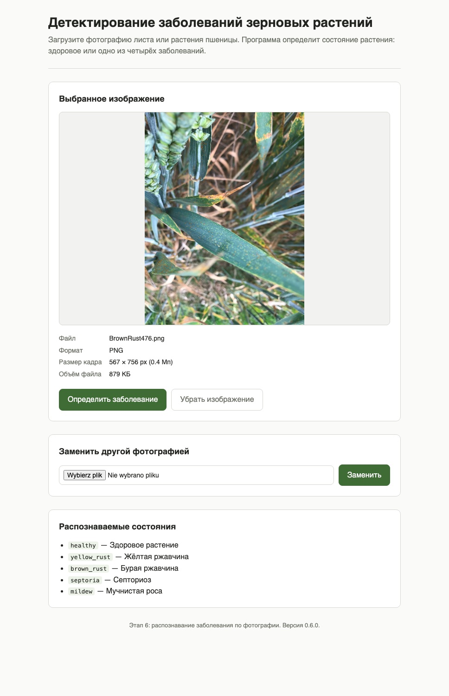
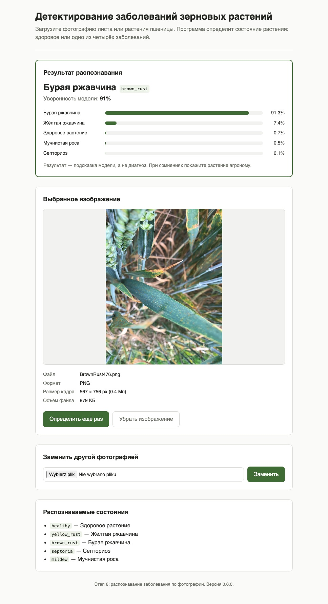
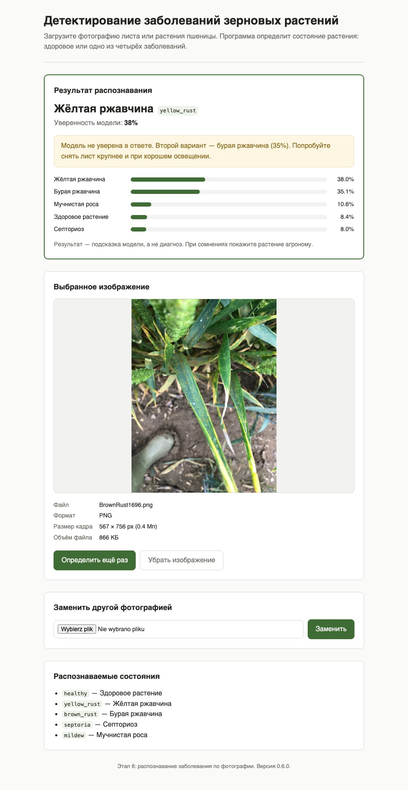

# Этап 6 — подключение модели к пользовательской программе

**Статус:** выполнен.

## Что требовалось по плану

> Пользователь может выбрать фотографию, нажать «Определить», получить результат.

## Что сделано

| Требование | Как закрыто |
| --- | --- |
| Пользователь может выбрать фотографию | форма загрузки из этапа 2, без изменений |
| Нажать «Определить» | кнопка «Определить заболевание» под снимком, `POST /predict` |
| Получить результат | над снимком появляется блок с названием состояния, уверенностью модели и вероятностями всех пяти классов |

Модель — первая модель этапа 4 (`models/stage4.pt`), вызывается через тот же
`predict()`, на котором на этапе 5 измерялось качество. Поэтому в приложении
модель ведёт себя ровно так, как в отчёте этапа 5.

## Как запустить

```bash
uvicorn src.app.main:app --reload
```

Открыть <http://127.0.0.1:8000>, выбрать фотографию, нажать «Определить заболевание».

## Пользовательский сценарий

Пользователь выбрал снимок. Под ним кнопка «Определить заболевание».



После нажатия сверху появляется результат: название состояния по-русски,
код класса, уверенность модели и вероятности всех пяти классов по убыванию.
Снимок остаётся на странице, его можно заменить или распознать ещё раз.



Если уверенность ниже 60%, программа прямо говорит, что модель не уверена,
и называет второй по вероятности вариант. На снимке ниже модель ошиблась:
выбрала жёлтую ржавчину (38%), а на фото бурая. Верный ответ оказался вторым
вариантом (35%), и пользователь его видит.



Снимки для скриншотов взяты из тестовой выборки (`BrownRust476.png` и
`BrownRust1696.png`).

## Устройство

Изменения по сравнению с этапом 2:

| Файл | Что изменилось |
| --- | --- |
| `src/app/main.py` | `POST /predict` вызывает модель вместо ответа 501. Модель загружается один раз при старте приложения. `GET /health` сообщает, загружена ли модель |
| `src/app/settings.py` | порог низкой уверенности `LOW_CONFIDENCE_THRESHOLD = 0.6` |
| `src/app/templates/index.html` | блок «Результат распознавания» |
| `src/app/static/styles.css` | оформление результата и полос вероятностей |
| `tests/test_app_predict.py` | 9 тестов на распознавание через страницу |

Ответы `POST /predict`:

| Ситуация | Код | Что видит пользователь |
| --- | --- | --- |
| Снимок выбран, модель ответила | 200 | результат распознавания |
| Снимок не выбран | 400 | «Сначала выберите изображение» |
| Файла весов нет | 503 | «Модель недоступна…», снимок остаётся на странице |
| Модель не смогла прочитать снимок | 422 | «Не удалось обработать изображение моделью…» |

## Решения, принятые на этапе, и их причины

**Показываются вероятности всех классов, а не только ответ.** На этапе 5
accuracy модели 0,711, и в 89% случаев верный класс входит в два самых
вероятных. Полный список даёт пользователю увидеть второй вариант, когда
первый неверен.

**Предупреждение при уверенности ниже 0,6.** Порог подобран на val, а не на
test, чтобы не подгонять его под тестовую выборку:

| Уверенность | Снимков val | Верных ответов |
| --- | --- | --- |
| < 0,6 | 45 (30%) | 47% |
| ≥ 0,6 | 104 (70%) | 81% |

Ниже 0,6 модель права меньше чем в половине случаев, поэтому такой ответ
нельзя выдавать без оговорки. На test картина та же: 55% и 75%.

**Высокая уверенность не выдаётся за гарантию.** По этапу 5 девять ошибок из
43 модель делает с уверенностью 0,9 и выше. Поэтому под любым результатом
написано, что это подсказка модели, а не диагноз.

**Модель загружается при старте.** Иначе первый пользователь ждал бы загрузки
весов. Если весов нет, приложение всё равно запускается: выбор и показ снимка
работают, а на «Определить» приходит понятная ошибка вместо падения.

**Результат не сохраняется между запросами.** Распознавание быстрое (около
0,3 с) и всегда даёт один и тот же ответ на один и тот же снимок. При замене
или удалении снимка старый результат исчезает сам и не может оказаться рядом
с чужой фотографией.

## Проверка результата

```bash
pytest -q
uvicorn src.app.main:app --reload
```

30 тестов проходят. Новые тесты проверяют:
- показ класса и уверенности;
- порядок классов по убыванию вероятности;
- предупреждение о низкой уверенности со вторым вариантом;
- нажатие «Определить» без снимка;
- отсутствие весов;
- нечитаемый снимок;
- исчезновение результата при замене снимка;
- сквозной прогон реальной модели через страницу, в том числе на снимке
  `YellowRust1010.png` из датасета.

Сценарий проверен вручную на запущенном сервере: загрузка, «Определить»,
результат. Уверенность на `BrownRust476.png` (0,913) совпала со значением
в `reports/stage5/predictions.csv`.

## Артефакты этапа

```
src/app/main.py                    маршрут POST /predict с вызовом модели
src/app/settings.py                порог низкой уверенности
src/app/templates/index.html       блок результата
src/app/static/styles.css          оформление результата
tests/test_app_predict.py          тесты распознавания через страницу
reports/stage6/*.jpg               скриншоты сценария
```

## Что дальше, на этапе 7

Проверить, что система работает со всеми заявленными классами: собрать для
каждого класса отдельный контрольный набор и прогнать его через программу.
