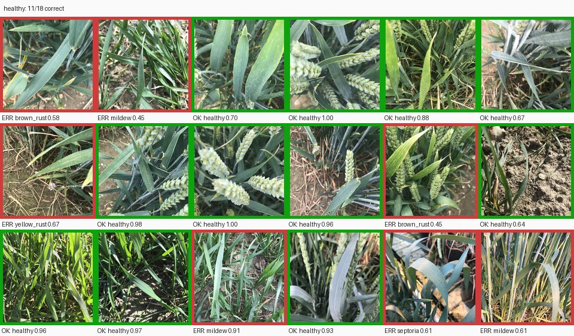
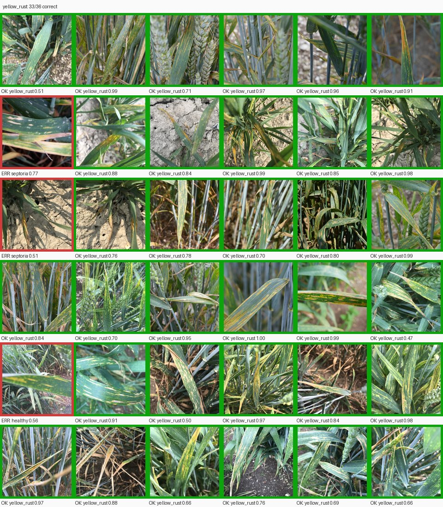
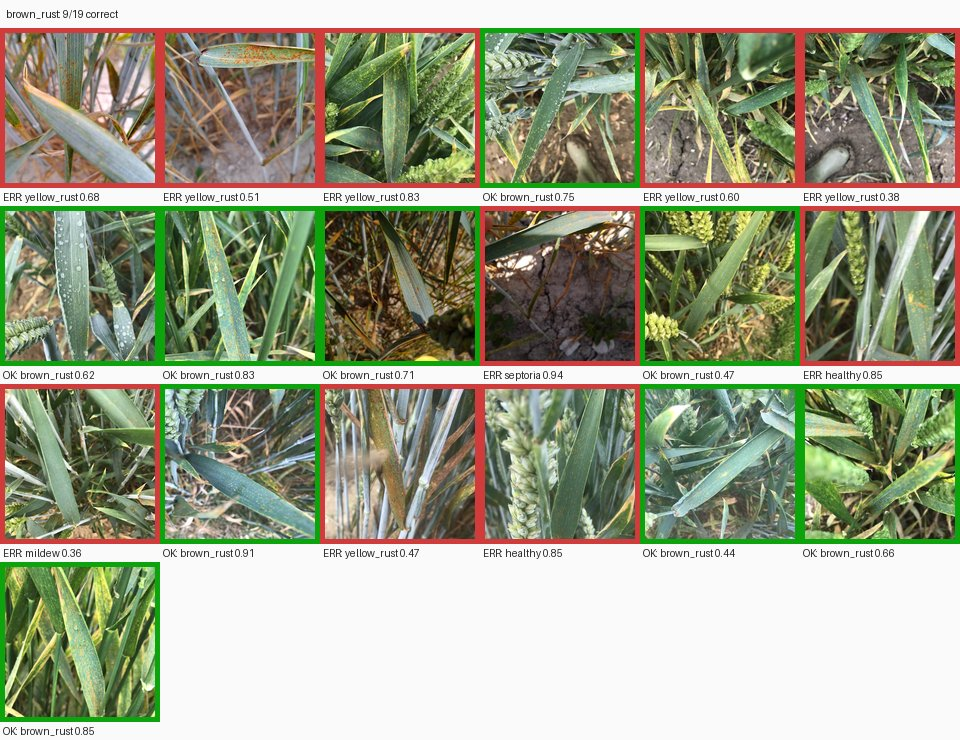
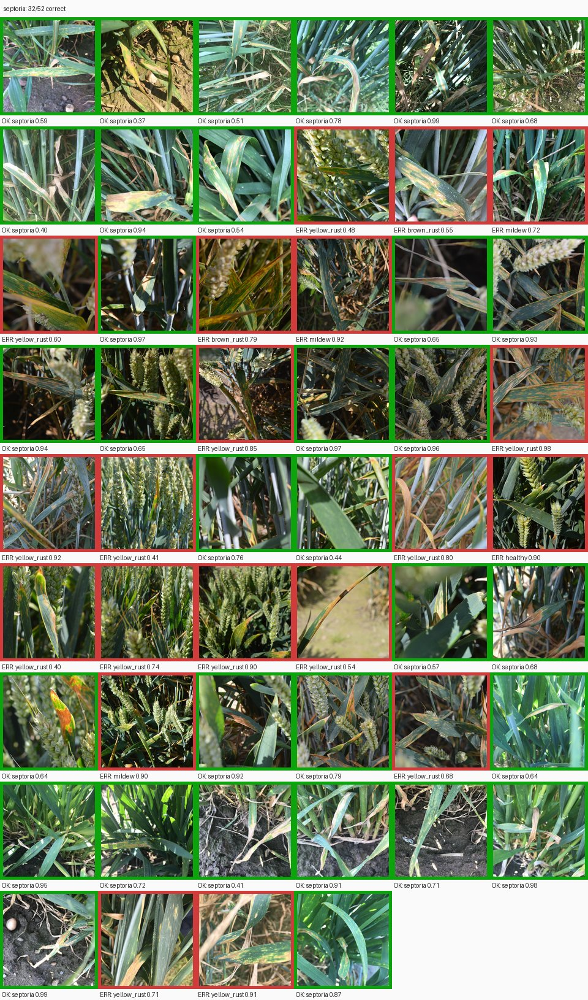
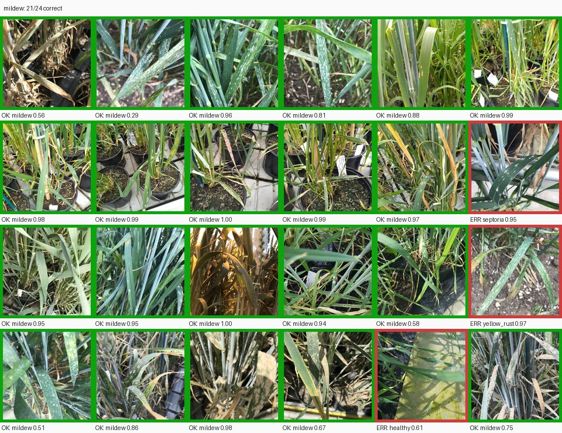

# Этап 7 — проверка всех заявленных классов

**Статус:** выполнен.

## Что требовалось по плану

> Убедиться, что система действительно работает со всем набором заболеваний.
> Для каждого класса имеется отдельный контрольный набор изображений.

## Что сделано

| Требование | Как закрыто |
| --- | --- |
| Отдельный контрольный набор для каждого класса | `data/control/<класс>.csv`, пять файлов, у каждого снимка записан md5 |
| Система работает со всем набором заболеваний | каждый контрольный снимок прошёл через программу так же, как у пользователя: загрузка, «Определить», ответ на странице. Для каждого класса вынесен вердикт PASS/FAIL по четырём проверкам |

**Итог: все пять классов прошли проверку.** Программа ответила на 149 снимков
из 149, без единой ошибки загрузки или распознавания.

## Контрольные наборы

| Класс | Название | Файл | Снимков |
| --- | --- | --- | --- |
| `healthy` | Здоровое растение | `data/control/healthy.csv` | 18 |
| `yellow_rust` | Жёлтая ржавчина | `data/control/yellow_rust.csv` | 36 |
| `brown_rust` | Бурая ржавчина | `data/control/brown_rust.csv` | 19 |
| `septoria` | Септориоз | `data/control/septoria.csv` | 52 |
| `mildew` | Мучнистая роса | `data/control/mildew.csv` | 24 |

Наборы взяты из тестовой выборки этапа 3. Это единственные снимки, которые
модель не видела ни при обучении, ни при выборе эпохи. Других размеченных
снимков пшеницы в проекте нет: все 998 изображений датасета уже распределены
по train/val/test, а полный набор на 19 172 снимка авторы выдают по запросу.

Каждый снимок в наборе — отдельная сцена, близких дублей внутри наборов нет
(группировка по dHash из этапа 3). В наборе `mildew` есть 4 JPEG, остальные
снимки — PNG, так что проверены оба формата, в которых пользователь пришлёт фото.

## Как запустить

```bash
python -m src.control.build   # сформировать контрольные наборы
python -m src.control.run     # прогнать их через программу
```

`src.control.run` завершается с кодом 0, если все классы прошли проверку,
и с кодом 2, если хотя бы один не прошёл. Поэтому команду можно ставить
в автоматическую проверку перед выпуском новой модели.

## Как устроена проверка

Скрипт поднимает веб-приложение этапа 6 и для каждого снимка делает то же,
что пользователь:

1. проверяет md5 файла по контрольному набору;
2. загружает файл через `POST /upload`;
3. нажимает «Определить» (`POST /predict`);
4. читает ответ со страницы: класс, вероятности всех классов, было ли
   предупреждение о низкой уверенности;
5. убирает снимок (`POST /reset`).

То есть проверяется не отдельно модель, а вся цепочка: проверка файла,
сохранение, вызов модели и вывод результата пользователю.

### Проверки для каждого класса

| Проверка | Условие прохождения |
| --- | --- |
| Класс заявлен везде | класс есть в `configs/dataset.yaml`, в весах модели и в списке «Распознаваемые состояния» на странице |
| Файлы целы | md5 каждого снимка совпадает с контрольным набором |
| Программа ответила на все снимки | ни одного отказа при загрузке или распознавании |
| Класс распознаётся лучше случайного угадывания | нижняя граница 95% доверительного интервала (Уилсон) для recall выше 0,2 |

Порог 0,2 — это доля верных ответов при случайном выборе одного класса из
пяти. Сравнивается нижняя граница интервала, а не сам recall: на 18–24 снимках
recall сильно колеблется, и одного удачного прогона недостаточно, чтобы
утверждать, что класс распознаётся.

Дополнительно проверяется, что модель не выдаёт классов, которых нет
в `configs/dataset.yaml`.

## Результат

### Поддержка классов

| | `healthy` | `yellow_rust` | `brown_rust` | `septoria` | `mildew` |
| --- | --- | --- | --- | --- | --- |
| `configs/dataset.yaml` | да | да | да | да | да |
| Веса модели | да | да | да | да | да |
| Интерфейс | да | да | да | да | да |

Лишних классов в модели нет.

### Распознавание по классам

| Класс | Верно | Recall | 95% ДИ | Precision | Top-2 | Итог |
| --- | --- | --- | --- | --- | --- | --- |
| `healthy` | 11 / 18 | 0,611 | 0,386–0,797 | 0,688 | 0,833 | **PASS** |
| `yellow_rust` | 33 / 36 | 0,917 | 0,782–0,971 | 0,600 | 0,972 | **PASS** |
| `brown_rust` | 9 / 19 | 0,474 | 0,273–0,683 | 0,692 | 0,895 | **PASS** |
| `septoria` | 32 / 52 | 0,615 | 0,480–0,735 | 0,865 | 0,846 | **PASS** |
| `mildew` | 21 / 24 | 0,875 | 0,690–0,957 | 0,750 | 0,917 | **PASS** |

Top-2 — доля снимков, у которых верный класс оказался первым или вторым
в списке вероятностей на странице.

### Что видит пользователь по классам

| Класс | Средняя уверенность | Доля ответов с предупреждением «не уверена» | Куда чаще всего уходит ошибка |
| --- | --- | --- | --- |
| `healthy` | 0,776 | 17% | `mildew` (3 снимка) |
| `yellow_rust` | 0,812 | 14% | `septoria` (2) |
| `brown_rust` | 0,669 | 32% | `yellow_rust` (6) |
| `septoria` | 0,741 | 25% | `yellow_rust` (14) |
| `mildew` | 0,840 | 17% | по одному в `healthy`, `yellow_rust`, `septoria` |

### Контактные листы

Каждый контрольный снимок с ответом программы. Зелёная рамка и «OK» — верно,
красная рамка и «ERR» — ошибка. В подписи — ответ программы и уверенность.







### Согласованность с этапом 5

Ответы программы совпали с предсказаниями `src.model.evaluate` на всех
149 снимках (`agreement_with_stage5 = 1.0`). Значит, пользователь получает
ровно ту модель, качество которой измерено на этапе 5. Ничего не теряется
при загрузке файла и не искажается при выводе на страницу.

## Выводы

1. **Система работает со всеми пятью заявленными классами.** Каждый класс
   заявлен одинаково в конфиге, модели и интерфейсе. Программа отвечает на
   каждый контрольный снимок и распознаёт каждый класс статистически лучше
   случайного угадывания.
2. **Самый слабый класс — `brown_rust`.** Нижняя граница recall 0,273 при
   пороге 0,2, запас небольшой. Почти треть ответов по бурой ржавчине идёт
   с предупреждением о низкой уверенности. При этом в 90% случаев верный
   ответ входит в два первых варианта, которые видит пользователь.
3. **`septoria` и `brown_rust` чаще всего путаются с `yellow_rust`:**
   14 и 6 снимков. Это совпадает с выводом этапа 5 и передаётся в этап 9.
4. **Ограничение проверки.** Контрольные наборы взяты из той же съёмки, что
   и обучающие данные (один датасет, одни авторы). На снимках с другой камеры
   или из другого региона качество может быть ниже. Для такой проверки нужен
   внешний набор, например полный датасет авторов по запросу.

## Решения, принятые на этапе, и их причины

**Наборы из test, а не из val или train.** Train модель видела при обучении,
val — при выборе лучшей эпохи. Только test честно показывает, как модель
поведёт себя на новых снимках.

**Проверка через веб-приложение, а не через `predict()`.** Требование этапа —
«система работает», а не «модель работает». Сквозной прогон находит
ошибки, которые прямой вызов модели не увидит: отказ в загрузке какого-то
формата, класс, забытый в интерфейсе, неверная подпись в результате.

**Критерий — интервал, а не точечный recall.** На 19 снимках разница между
recall 0,42 и 0,53 — один-два снимка. Интервал Уилсона показывает, что
класс распознаётся, с учётом малого размера набора.

**Наборы хранятся как CSV с md5, а не копиями файлов.** Сами снимки
восстанавливаются из архива Zenodo со сверкой md5, а контрольный CSV
гарантирует, что проверка идёт на тех же файлах.

## Артефакты этапа

```
configs/control.yaml                   источник наборов, порог, уровень доверия
src/control/build.py                   формирование контрольных наборов
src/control/run.py                     прогон наборов через программу и вердикт
data/control/<класс>.csv               контрольный набор каждого класса
reports/stage7/control_sets.json       состав наборов
reports/stage7/control_results.csv     ответ программы на каждый снимок
reports/stage7/control_summary.json    проверки и метрики по классам, итог
reports/stage7/sheets/<класс>.jpg      контактные листы с ответами
tests/test_control.py                  тесты наборов, критериев и разбора ответа
```

## Проверка результата

```bash
pytest -q
python -m src.control.build
python -m src.control.run
```

Ожидается: 40 тестов проходят, `src.control.run` печатает PASS для всех
пяти классов, «Ответов программы: 149 из 149» и завершается с кодом 0.

## Что дальше, на этапе 8

Первый рабочий пользовательский сценарий (MVP): довести путь пользователя
от выбора снимка до результата до законченного вида.
