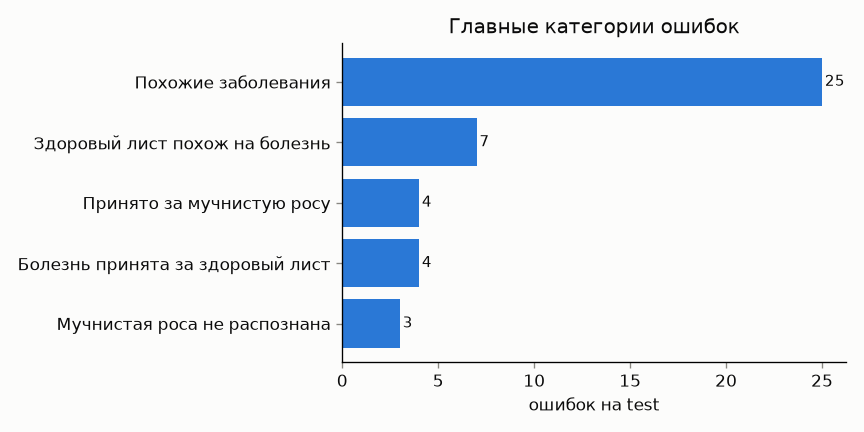
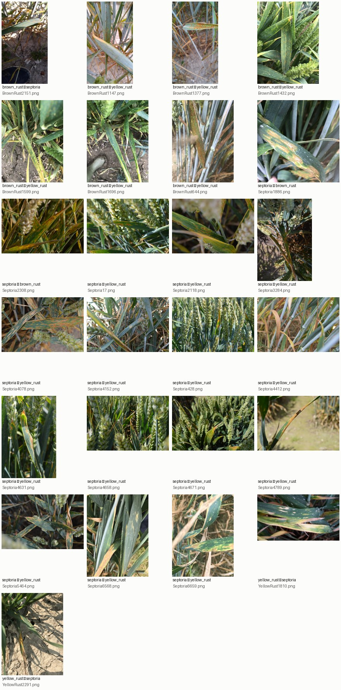
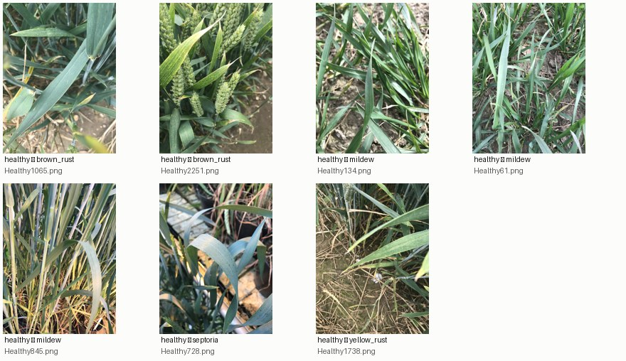
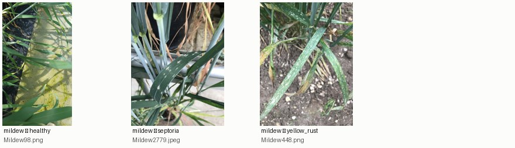
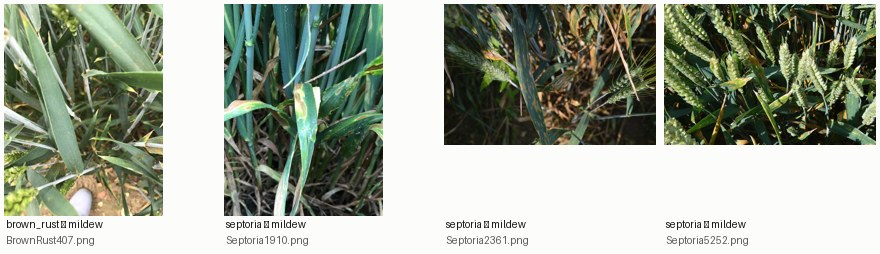
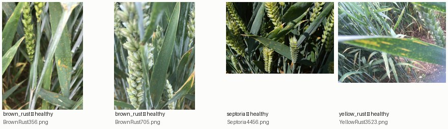

# Этап 9 — анализ ошибок модели

**Статус:** выполнен.

## Что требовалось по плану

> Определить, почему и где система ошибается. Собраны повторяющиеся категории
> ошибок. Например, два заболевания визуально похожи, сложный фон, плохое
> освещение, симптомы занимают небольшую часть листа.

## Что сделано

Разбор идёт по предсказаниям этапа 5: те же веса `models/stage4.pt` и тот же
`data/processed/splits/test.csv` (149 снимков, 43 ошибки). Модель заново не
обучалась. Каждая ошибка получила одну главную категорию, а условия съёмки
посчитаны и для верных кадров, чтобы не назвать причиной то, что на тесте
встречается одинаково часто.

| Требование | Как закрыто |
| --- | --- |
| Где ошибается | пары «истина → предсказание» и пять главных категорий, в сумме 43 |
| Почему | просмотр всех 43 ошибок и признаки кадра: яркость, резкость, доля почвы и пятен |
| Похожие заболевания | 25 ошибок между `yellow_rust`, `brown_rust` и `septoria` |
| Сложный фон | 13 ошибок, доля выше, чем у верных кадров (30% против 20%) |
| Плохое освещение | 13 ошибок, доля примерно вдвое выше, чем у верных (30% против 14%) |
| Малый симптом | признак посчитан; на верных кадрах он встречается чаще, поэтому сам по себе ошибку не объясняет |

## Как запустить

```bash
python -m src.model.errors
```

Нужен уже посчитанный `reports/stage5/predictions.csv`. Если его нет:

```bash
python -m src.model.evaluate
python -m src.model.errors
```

## Главные категории

Категории не пересекаются: у каждой ошибки одна. Порядок выбора зафиксирован
в `primary_category`.



| Категория | Ошибок | Доля ошибок |
| --- | --- | --- |
| Похожие заболевания | **25** | 58% |
| Здоровый лист похож на болезнь | 7 | 16% |
| Чужой класс принят за мучнистую росу | 4 | 9% |
| Болезнь принята за здоровый лист | 4 | 9% |
| Мучнистая роса не распознана | 3 | 7% |

### Похожие заболевания — 25

Жёлтая ржавчина, бурая ржавчина и септориоз на полевом снимке дают жёлто-бурые
полосы и крап. Модель почти всегда выбирает жёлтую ржавчину.

| Истина → предсказание | Снимков |
| --- | --- |
| `septoria` → `yellow_rust` | 14 |
| `brown_rust` → `yellow_rust` | 6 |
| `septoria` → `brown_rust` | 2 |
| `yellow_rust` → `septoria` | 2 |
| `brown_rust` → `septoria` | 1 |

Примеры: `Septoria4078.png` (уверенность 0,98) — жёлто-бурые полосы вдоль листа
и колосья в кадре; `BrownRust1432.png` (0,83) — редкие оранжевые пустулы вместе
с жёлтыми точками, их легко принять за полосы жёлтой ржавчины.

В 27 ошибках из 43 истинный класс стоит на втором месте по вероятности.
Путаница похожих болезней часто видна уже в двух верхних вероятностях, а не
только в ответе argmax.



### Здоровый лист похож на болезнь — 7

У здоровых листьев желтеют кончики, есть сизый налёт или капли воды. Это не
пятно болезни, но модель читает их как симптом.

| Снимок | Ответ | Что на кадре |
| --- | --- | --- |
| `Healthy61.png` | `mildew`, 0,91 | сизые листья в поле, без горшка |
| `Healthy845.png` | `mildew`, 0,61 | горшки и пожелтевшие нижние листья |
| `Healthy728.png` | `septoria`, 0,61 | капли на бледном листе, на фоне горшки |
| `Healthy1065.png` | `brown_rust`, 0,58 | жёлтые края листьев |



### Мучнистая роса — 3 промаха и 4 ложных

На этапе 3 была гипотеза: `mildew` снят в горшках и теплице, модель выучила фон,
а не налёт. Просмотр ошибок эту гипотезу не подтверждает.

- `Mildew2779.jpeg` снят у горшка, налёт на листе виден, модель отвечает
  `septoria` с уверенностью 0,95.
- `Mildew448.png` снят в поле на почве, налёт есть, но лист ещё и желтеет.
  Ответ — `yellow_rust`, 0,97.
- Ложные `mildew` есть и на полевых кадрах (`Healthy61.png`, три снимка
  `septoria`), а не только на горшках.

Доля очень тёмных пикселей (грубый признак «чёрный горшок») у `septoria` на
test даже выше, чем у `mildew` (медиана 0,086 против 0,046). Тёмный кадр и
горшок этим признаком не различаются. Высокий recall `mildew` на этапе 5
нельзя списывать только на фон.





### Болезнь принята за здоровый лист — 4

Симптом редкий или теряется среди колосьев. `BrownRust356.png` и
`BrownRust705.png` — отдельные мелкие пустулы, оба ответа `healthy` с
уверенностью около 0,85. `Septoria4456.png` тёмный, в кадре в основном
колосья, ответ `healthy` с уверенностью 0,90.



## Условия съёмки

Признаки считаются по кадру 224×224, пороги записаны в `src/model/errors.py`.
Один кадр может попасть в несколько условий. Сравнение — доля среди 43 ошибок
и среди 106 верных ответов.

| Условие | Ошибок | Доля ошибок | Доля верных |
| --- | --- | --- | --- |
| Плохое освещение (средняя яркость < 95 или ≥ 20% почти чёрных пикселей) | 13 | **30%** | 14% |
| Сложный фон (почва ≥ 18% кадра или мало листа и заметная почва) | 13 | **30%** | 20% |
| Смазанный кадр (дисперсия лапласиана < 700) | 7 | 16% | 9% |
| Мало пятен (оранжевых < 3,5% и жёлтых < 7%, не для `healthy`) | 16 | 37% | **52%** |

Плохое освещение — единственное условие, которое на ошибках встречается
примерно вдвое чаще. Ему подвержен в первую очередь `septoria`: тёмные полевые
кадры уходят в `yellow_rust` и `mildew`.

Сложный фон (почва, колосья, сухая солома, иногда ботинок в кадре) встречается
чаще на ошибках, но разрыв небольшой: такие кадры есть и среди верных ответов.

Малая площадь симптома ошибку не отделяет. Порог «мало оранжевого и жёлтого»
срабатывает на 52% верных снимков и только на 37% ошибок: модель часто узнаёт
и мелкие пятна. Мелкие пустулы важны точечно — в категории «болезнь принята за
здоровый лист», — а не как общая причина всех 43 ошибок.

Девять ошибок сделаны с уверенностью 0,9 и выше. Порог уверенности их не
отсечёт; это вход для этапа 12, а не повод менять порог уже здесь.

## Выводы для этапа 10

1. Главная цель улучшения — путаница `septoria` / `brown_rust` / `yellow_rust`,
   в особенности перекос в `yellow_rust` (20 из 25 ошибок этой категории).
2. Имеет смысл усилить устойчивость к тёмному кадру: это единственное условие
   съёмки с явной разницей между ошибками и верными ответами.
3. Не стоит ждать прироста от отсечения «маленького симптома»: такой кадр
   чаще оказывается верным.
4. Гипотезу «горшок = мучнистая роса» по этим ошибкам не подтверждаем.
   Менять обучение только ради фона `mildew` нет причины.

## Решения, принятые на этапе, и их причины

**Разбор на фиксированном test, без нового обучения.** Иначе категории
описывали бы другую модель, и этап 10 было бы не с чем сравнивать.

**Одна главная категория на ошибку.** Иначе одни и те же 14 кадров
`septoria → yellow_rust` попали бы и в «похожие болезни», и в «фон», и счёт
категорий нельзя было бы сложить.

**Условия съёмки сравниваются с верными кадрами.** Сложный фон и мелкие пятна
есть почти на всём датасете. Без сравнения с верными ответами любой порог
выглядел бы как объяснение ошибки.

**Признаки кадра — грубые цветовые доли, не разметка пятен.** Пятен в датасете
нет, поэтому доля оранжевого и жёлтого только приближает «симптом». Пороги
зафиксированы в коде и покрыты тестами.

## Артефакты этапа

```
src/model/errors.py                         категории, признаки кадра, листы
reports/stage9/summary.json                 счётчики категорий и условий
reports/stage9/errors.csv                   43 ошибки с категорией и признаками
reports/stage9/conditions.csv               те же признаки для всех 149 снимков
reports/stage9/categories.png
reports/stage9/sheets/                      контактный лист на категорию
tests/test_errors.py
```

## Проверка результата

```bash
pytest -q tests/test_errors.py
python -m src.model.errors
```

Ожидается: тесты зелёные, команда печатает 43 ошибки, из них 25 в категории
«Похожие заболевания».

## Что дальше, на этапе 10

Сравнить текущие веса с одной улучшенной моделью на этом же `test.csv`.
Имеет смысл бить в перекос к `yellow_rust` и в тёмные кадры, а не в отсев
мелких пятен.
